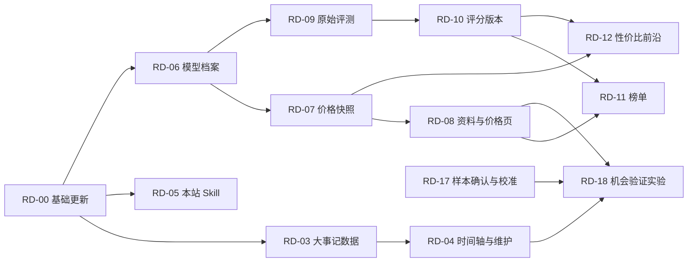

# AI机会雷达二次开发路线与任务

版本：2026-10-12。上游基线：[`931a4eb`](https://github.com/KKKKhazix/AIHOT/commit/931a4eb5edf344b12b9e65f0d039f7c52a2e0792)。本仓库：[niu1147713149-png/AIHOT](https://github.com/niu1147713149-png/AIHOT)。

本轮交付是更新开源引擎、保存本站定制、建立 fork 和规划后续任务。除下表标记完成的基础工作外，新增模块均为待开发。功能判断依据见[原站研究](reference-site-audit-20261012.md)，当前版本的实际检查见[升级记录](upstream-upgrade-20261012.md)。研究中的来源数量、文章量、模型分数是当时快照，不是本站验收指标。

## 目标与约束

服务做国内业务的个人和小团队，优先支持 AI 工具服务、内容创作、流程自动化。要帮助读者回答三个问题：发生了什么变化，能否用于国内的具体任务，值得验证什么客户需求。海外产品发布不能直接推导为国内可用或有利润。

首版按小批次交付，不承诺按日期复刻原站全部内容。优先复用已授权的 21 个 RSS、44 个主题、统一发布层、后台和任务队列。保留本站品牌、现有分类键与主题 slug、`myhot` MCP 前缀、精选门槛和使用规则模板状态。当前运行模型是 `gpt-6.1-sol`，其凭据只放在本地环境中。

开发投入与月度费用尚未确定；这既不是无限预算，也不代表外部 API 免费。新增模块首版优先用现有资料、人工导入和公开的一手来源。付费评测、额外模型批处理、X/公众号服务、大规模扩源及通知启用，应在对应任务开始前确定费用或发送范围。域名、运营主体、隐私条款与公网发布继续延后。

## 功能差距与处理方式

| 原站内容 / 能力 | 升级后的本地基础 | 二开处理 |
|---|---|---|
| 精选、全部动态、热点、事件、日报周报月报 | 框架已有 | 保留，优先检查采集和出刊连续性（RD-02） |
| 阅读字体、原生视频、长文目录、人工评分更正 | 本次上游更新已包含 | 随基础回归验收，不重复开发 |
| 公司编年史、技术方向大事记 | 主题与事件已有，大事记模块缺少 | RD-03、RD-04 |
| 模型资料、国内可用条件、价格详情 | 缺少模型资料模块 | RD-06、RD-07、RD-08 |
| 综合与分领域模型榜、评测来源 | 缺少评测数据与榜单系统 | RD-09、RD-10、RD-11 |
| 性价比散点图与“斩杀线” | 缺少可比分数与场景价格 | RD-12，依赖价格和评分两条链 |
| 本站 Agent Skill | 已有 Agent Markdown、API、RSS、7 个 MCP 工具 | RD-05 封装接入，不重做问答后台 |
| Tibo Codex 重置监控 | 缺少专用模块 | RD-15，可选，晚于应用选型功能 |
| X、公众号、网页、JSON 来源 | 框架支持，本站实际仅 RSS | RD-13 与 RD-14 分批配置 |
| 飞书内容推送 | 框架已有，当前关闭 | RD-16；重置事件另接通知规则 |
| 国内应用商机判断 | 已有提示词取向和 100 条 AI 初标 | RD-17 校准；RD-18 为本站特有的后续实验 |

原站模型榜没有公开 API；其生产评分矩阵、冻结参数和历史资料未在开源库中提供。可独立实现同类功能，但不能承诺每个分数、每篇历史文章或完整信源清单与原站一致。原站后台未完整研究，不按推测复制。

## 分批交付

采用“用户价值 / 依赖 / 数据可得性”排序。没有经验证的用户覆盖量和人力估算，因此不编造 RICE 分数或排期。

| 批次 | 用户能完成的事 | 任务 | 退出条件 |
|---|---|---|---|
| 当前：基础同步 | 在自己的仓库继续维护可运行的站点 | RD-00、RD-01 | 备份可追溯，合并与验证有记录，fork 含本站代码和规划 |
| 下一批：趋势与选型最小版 | 看主题变化、查模型资料和价格、让本机 Agent 查询资讯 | RD-02 至 RD-08 | 大事记可更正撤回，价格能追溯来源，Skill 引用正确，网页读取不调用模型 |
| 再下一批：完整选型 | 按场景看能力、成本和替代方案 | RD-09 至 RD-12 | 数据足够才出榜；同输入可重算；缺测不冒充 0 分；成本可复算 |
| 按需扩展 | 补国内一手资料、接收已选通知、查询重置消息 | RD-13 至 RD-16 | 数据与费用路线确定；去重、限流、陈旧状态和通知范围通过验收 |
| 持续校准 | 减少无用资讯，把线索转为可验证的小任务 | RD-17、RD-18 | 人工确认样本；记录建议有用与否，不能以点击量当盈利证据 |

建议的价值验证：在第一批上线后记录 7 天的阅读反馈，检查“每周能找到 3 条愿意继续核实的国内应用线索”是否成立。3 条是待验证的试用目标，不是已有产出或营收承诺；先用本地记录，不新增跨站用户追踪。

## 任务清单

状态只有“完成、进行中、待开发、待业务输入”。S 表示一个较独立的交付面，M 涉及前后端或数据维护，L 涉及多源校准和长期运维；这些是相对规模，不是人数、价格或天数。后续一次只拉取一个可验收的任务，完成后更新本文件。

| ID | 状态 | 优先级 / 规模 | 交付 | 依赖 |
|---|---|---|---|---|
| RD-00 | 完成（保留上游已复现问题） | P0 / M | 备份、上游同步、本站合并与本地验收 | 无 |
| RD-01 | 完成 | P0 / S | 个人 fork、远程关系、研究与任务文档 | RD-00 |
| RD-02 | 待开发 | P1 / S | 本地运行、采集与出刊健康基线 | RD-00 |
| RD-03 | 待开发 | P1 / M | 主题大事记数据、候选与更正链 | RD-00 |
| RD-04 | 待开发 | P1 / M | 主题页时间轴与后台维护 | RD-03 |
| RD-05 | 待开发 | P1 / S | 本站 Skill 包与接入说明 | RD-00 |
| RD-06 | 待开发 | P1 / M | 模型档案和可用条件 | RD-00 |
| RD-07 | 待开发 | P1 / M | 官方 / 渠道价格快照 | RD-06 |
| RD-08 | 待开发 | P1 / M | 模型与价格资料页、对照表 | RD-06、RD-07 |
| RD-09 | 待开发 | P2 / L | 多来源原始评测与审查 | RD-06 |
| RD-10 | 待开发 | P2 / L | 评分方法实验、版本与发布 | RD-09 |
| RD-11 | 待开发 | P2 / M | 综合 / 分领域榜与来源页 | RD-08、RD-10 |
| RD-12 | 待开发 | P2 / M | 场景成本与帕累托前沿 | RD-07、RD-10 |
| RD-13 | 待开发 | P1 / S | 少量国内官方信源候选与质量核查 | RD-02 |
| RD-14 | 待业务输入 | P2 / M | 费用口径、批量处理上限和付费扩源 | 月度上限、RD-13 |
| RD-15 | 待业务输入 | P3 / M | Codex 重置监控 | 同步 / 独立采集路线 |
| RD-16 | 待业务输入 | P3 / S | 飞书等通知配置与去重验收 | 接收目标、发送范围；付费源另依赖 RD-14 |
| RD-17 | 待业务输入 | P1 / M | 确认 100 条初标并校准口味 | 用户确认标签；付费评测依赖 RD-14 |
| RD-18 | 待开发 | P2 / M | 国内应用机会的验证清单实验 | RD-04、RD-08、RD-17 |

### RD-00 / RD-01：当前工作

交付：备份 dirty 工作树和私有配置，更新到核验过的上游提交，合并本站定制，创建个人 fork。`origin` 指向个人仓库，`upstream` 指向 `KKKKhazix/AIHOT`；后续站点改动只进入自己的 fork。测试结果、部署状态、未解决问题写入升级记录。

验收：最新上游提交在本地历史中；21 源、44 主题、品牌和模型配置正确；完成仓库规定的检查；fork 的提交及文件可通过 GitHub 官方接口读取。`.env`、数据库、`.data/`、原站下载材料、私有标注文件不得进入提交。保留 MIT 许可及上游归属，不向上游提交本站运营定制。

### RD-02：本地可靠运行

交付：复用已有运行后台、信源状态和日报缺期告警，写出“Docker 未启动 / web 故障 / 采集停滞 / 模型失败”的诊断顺序；记录当前基线，修复确认发生的问题。此前网站曾因 Docker Desktop 未运行而不可访问，不能仅靠容器的 `restart` 配置解决宿主未启动。

验收：Docker 启动后四个常驻服务恢复，`setup` 成功退出被视为正常；首页和后台可访问；至少观察一个采集周期和出刊状态，区分无资讯与任务失败。给出本机自动启动的可选方案；启用宿主登录自启须单独确定。不能新增一个未经配置的“保证永不掉线”承诺。

已确认的网页回归缺陷也纳入本任务：WebKit 中折叠日期后进入长列表文章再返回，原阅读锚点未恢复。2026-10-12 本站网页测试 49/50 通过；未定制的上游 `931a4eb` 在相同 Linux / WebKit 环境中也复现该项。定位并修复后，需在完整导航测试序列与单项用例中验收，不能删除断言或放宽位置误差来消除失败。

### RD-03 / RD-04：主题大事记

模块：`modules/topic-milestones/`。数据包括主题、事件日期及精度、事件类型、标题、原始证据链接、关联文章 / 事件、审核状态和修订记录。首版用现有发布资料和人工补录，不启动全历史模型回填。

RD-03 验收：同一主题内同一事件只保留一条有效里程碑；候选、已确认、撤回状态明确；文章撤回、证据失效、主题或日期更正能影响展示；引用只能读统一发布层允许的内容；旧迁移不改，新表用模块迁移。用重复事件、未知日期、全部证据撤回、部分证据仍有效等案例验证。

RD-04 验收：公司页分模型与产品 / 公司事件，技术主题展示重要进展，教程等主题不强加时间轴；可加载更早事件；无资料时不编造历史。后台仅管理员可新增、更正、撤回并记录理由。桌面和手机下都能读日期、证据与关联报道；至少以公司、技术、空数据主题各验收一个页面。

### RD-05：本站 Agent Skill

首版交付 `modules/agent-skill/files/` 下的 Skill、README 和校验清单；模块注册固定文件路由，用现有 `sendFile` 接口提供下载，在 Agent 扩展口添加安装说明。包内查询使用现有 `/api/v1/agent`。支持配置站点地址，默认使用本机地址；不把模型或管理员密钥放进包里。

验收：本机 Agent 能查询最新资讯、指定主题和报告，回答保留原文、站内链接及时间；空结果与站点不可达明确返回；读取过程不触发本站新模型调用。安装、卸载、版本检查可复现。说明云端 Agent 无法直接访问用户电脑的 localhost；首版不要求公网发布。

### RD-06 / RD-07 / RD-08：模型资料与价格最小版

模块：`modules/model-catalog/`。首版先选最多 10 个与国内工具服务相关的模型，具体名单在实施时根据官方资料确认；每个供应商至少核对版本标识、调用方式、地区条件、上下文和许可来源。数量是首批范围上限，不编造缺失数据。

RD-06 验收：稳定模型 ID 与提供商的调用 ID、别名分开；不同版本、推理配置不能自动混为同一模型。“国内厂商”“国内可调用”“开放权重”“允许商用”分别有字段及证据，不合并成一个国产 / 开源标记；未知明确标为未知。

RD-07 验收：价格包含输入、输出、缓存、计量单位、币种、价格生效时间、核验时间和来源。官方价格与用户实际渠道价格分别记录；缺价与免费不同。长上下文、批量、缓存写入等无法按普通单价计算时明确条件。来源失效保留最近一次快照并提示陈旧，不自动归零。不读取或上传用户渠道密钥。

RD-08 验收：模型列表、详情和价格对照能按国内可用证据与任务类型筛选，展示来源和更新日期；不把“只有资料”展示成“已有能力排名”。移动端可用，空值可理解；选择两个模型可复算同一场景费用。后台支持导入预览、逐条审核和错误修订。

数据路线：优先官方模型文档、定价页和可公开引用的发布说明；首批人工导入，稳定后再增加 allowlist 采集。候选可包括国内主流模型及必要的海外参照，但本站使用的渠道模型名不自动等同于可独立核验的官方模型版本。

### RD-09 / RD-10 / RD-11：有证据的模型榜

模块：`modules/model-leaderboard/`，依赖模型档案。先核验拟接入评测源的版本、授权、接口和模型配置；可研究官方评测材料、公开排行榜及能取得原始成绩的数据集。公开可读不代表可无限批量复制，不能默认都免费或可商业再发布。

RD-09 验收：至少接入两个经过审查的独立来源，记录基准版本、原始值、方向、单位、模型精确版本、推理 / 工具配置、来源时间、采集时间及采用 / 排除理由。用别名冲突、真实 0 分、缺测、失效来源和修订成绩验证；做不到跨源可比时只展示原始成绩。

RD-10 验收：先输出方法说明及离线实验，不直接套上原站的分数名称。模型入榜覆盖条件、归一化、同类评测去重、权重、参照集合与缺测规则均版本化；固定输入快照可重复计算并追溯每个分数。用留出基准、离群点和配置变化做敏感性检查；缺少足够覆盖时不发布综合排名。原站 v19 规则可作研究参考，未拿到生产参数时不能声称同分复现。

RD-11 验收：综合榜和编程、科研、专业办公、知识问答视图共用同一评分版本；详情页能回溯采用的原始成绩及排除原因；国产 / 开放权重等过滤来自档案证据。数据不足、更新失败、排名不确定性明确显示。分数更新与价格更新时间分开，不能用价格新鲜掩盖评测过期。

### RD-12：场景成本与性价比前沿

复用模型价格与可比分数，在同一任务场景、币种和评分版本下计算。输入参数包括输入 / 输出 token 数、缓存命中率、价格渠道和地区可用条件。首版不做需要付费模型请求的实时跑分。

普通 token 定价的基础公式：`费用 = (输入量 × ((1 - 命中率) × 输入单价 + 命中率 × 缓存单价) + 输出量 × 输出单价) / 1,000,000`。仅适用于所选模型确认支持该定价方式的条件；命中率为 0 时不要求缓存单价，未知缓存价且命中率大于 0 时不能给出伪精确结果。

验收：一个模型被另一个“成本不高且分数不低、至少一项严格更优”的模型支配时不在前沿；相同点、零价格、未知价格、缺评分、币种不一致、缓存不支持、阶梯价边界有测试。图表与表格结果一致；读者能看到导致结果的输入与快照。只展示能力 / 价格关系，不等同于业务利润。

### RD-13 / RD-14：国内信源与费用管理

RD-13 首批只整理、验证最多 5 个高价值候选，优先国内产品的官方更新、API / 商用许可 / 定价变更，以及有可核实流程的实践。复用已有三家国内媒体，避免重复转载提高虚假热度。新增名单在启用前交使用者确定。

验收：每源有所有者、类型、分级、更新节奏、正文许可、试抓样本、时区和失败方式；RSS / 网页 / JSON 优先，预览不应触发批量模型处理。启用后的 7 天按有效线索、重复 / 噪声、抓取成功、调用量评估，允许暂停无价值来源。

RD-14 验收：先确定月度金额上限和供应商计费口径，记录 token 使用、来源处理量及估算误差；不能把当前“请求次数熔断”称为费用预算。设计是否需要金额阻断时说明渠道价格变动和未知计费的处理。付费 X / 公众号采集、完整基准运行、历史重评必须有单独范围和费用估计；没有预算输入时停留在候选与模拟数据。

### RD-15 / RD-16：可选监控与通知

RD-15 模块：`modules/codex-reset/`。本地研究可评估原站公开 API 同步，至少间隔 10 分钟并使用 ETag；若用于对外业务，先确定其数据许可，或采用有授权的独立公告来源。记录原帖、预计 / 确认时间、事件类型、核验状态和采集时间。

验收：预计时间经过不能当作确认；发卡不等于重置；支持原时区、夏令时和北京时间；重复消息不重复显示。原站返回 `attention` 或核验滞后时照实呈现。该功能不访问私人账号余额，也不替用户执行重置。

RD-16 优先配置现有飞书内容推送，不重写通用通知服务；重置模块事件另用框架扩展口。目标群、收件范围、频次、静默时段和启用时点确定后再发送。

验收：本地假接收器验证去重、失败、重试及停用；实发前核对具体内容与目标。普通精选与重置消息分别可解释，不发送未核验的“已恢复”通知。不把规划文件或测试成功当成已经配置了持续监控。

### RD-17 / RD-18：把资讯转成可验证线索

RD-17 复用本地已完成的 100 条 AI 初标，先请用户确认 / 修订，特别是 30 条两可样本；不重新随机抽样掩盖争议，不把 AI 标签称为人工金标。保留事件隔离的开发 / 留出集，标签与原因可追溯。经预算确定后再运行模型评测，报告误选、漏选、失败和不确定样本，之后才决定是否调整门槛。

RD-18 是本站特有的后续实验，不是对原站已验证功能的复制。可在主题或模型资料旁关联“面向谁、解决什么任务、有什么证据、国内条件、成本、下一步小实验”；缺乏证据时列为待核实，不能补写客户数、收入或利润。首批用 10 条已经人工确认的线索验证，建议应能追溯到文章 / 产品文档；记录用户是否愿意实际验证及原因，再决定是否扩展自动生成。

## 依赖与工程落点

新增模块依次接入 `site/modules/index.ts`、`server.ts`、`web.ts`，注册 `site/package.json` 依赖，并按框架要求给 Dockerfile 增加模块 package.json 的复制。模块可包含 `module.ts`、`server.ts`、`web.tsx`、`migrations/`、`tests/`。各任务应在修改前再次核对现有插口，不预先制造未使用的通用抽象。

统一发布层控制公开证据，前端只通过 API 读取；新增公开路由遵循同样的撤回和全文许可条件。阅读页面不能触发付费模型调用，后台写操作须管理员认证和审计；worker 的付费任务继续用回执与预算机制。模块迁移使用新文件名，不修改已发布迁移，尤其不能改 `0053_drop_leaderboard_monitor.sql` 来恢复旧榜单。

每批完成时执行仓库要求的 `npm run typecheck`、独立 `_test` / `_ci` 库的 `npm test`、前端构建和网页回归、部署后的 `node scripts/smoke.ts --base http://localhost:3080`，并覆盖该模块的空数据、失效来源、撤回、陈旧状态和手机页面。所有测试只连接本地假外部服务，不能读生产密钥或生产库；部署前备份数据和旧镜像，按[部署文档](deploy.md)停止旧服务、迁移、再启动。

## 仍需在对应阶段决定的事

1. 月度金额与一次性开发 / 数据采购投入上限。未给出前不启用新增付费来源或批量评测。
2. 第一批模型名单、优先国内客户任务，以及最终采用哪些候选信源。上面的顺序可直接用于开工准备，名单在实施时结合可获取证据确认。
3. 100 条初标的人工确认；原站数据同步与独立维护的取舍；如启用通知，确定接收目标和范围。

域名、对外主体和隐私条款不是本地二开前置条件。原站数据商业授权也不是独立开发功能的前置条件，只有采用其受约束的数据路线时才需处理。
